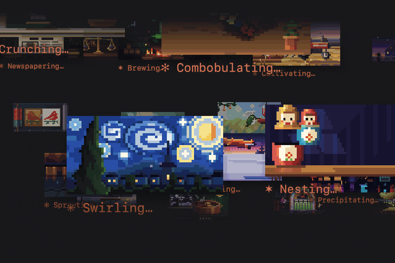

# verbs



A Claude Code plugin that plays a looping pixel-art picture above the spinner while Claude works, one for each of the spinner's 188 verbs.

Unofficial, not affiliated with Anthropic.

## Install

```sh
claude plugin marketplace add olliewagner/verbs
claude plugin install verbs@verbs
```

Then restart Claude Code if it is open. The picture plays from the first prompt of the next session.

The website, https://ollie.md/verbs, plays every verb.

## Uninstall

```sh
claude plugin uninstall verbs@verbs
claude plugin marketplace remove verbs
```
